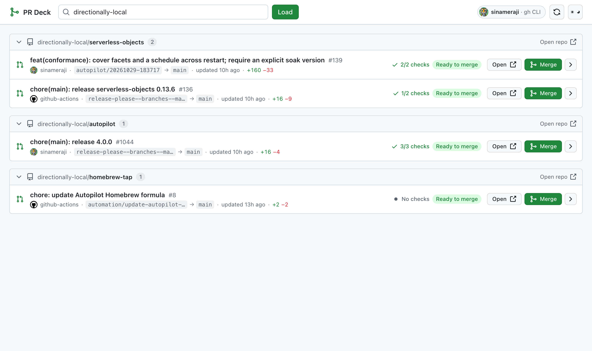

# PR Deck

**Every open pull request in a GitHub org or user account, on one screen.**

No more clicking through twelve repositories to find out what is waiting on you. PR Deck lists every repo that has open PRs, shows exactly what is blocking each one, and lets you merge without leaving the page.



## Why

Reviewing a busy org means opening repo after repo, tab after tab, just to answer one question: *what can I merge right now?* PR Deck answers it in one view, using the GitHub account you already have.

## Features

- **One screen, every repo.** All open PRs grouped by repository, with counts, branch names, authors, diff stats and age.
- **Merge from here.** Merge commit, squash, or rebase, with an optional "delete branch after merge". A confirmation dialog shows the PR and the method before anything happens.
- **See what is blocking.** Required reviews, changes requested, failing checks, merge conflicts, behind base branch, drafts — each PR gets a plain-language status.
- **Live CI.** Per-check status with workflow name, duration and a link to the logs. Running checks animate; failed ones are called out.
- **Fix it without leaving.** Re-run failed jobs, or update a branch that is behind its base.
- **Always a link to GitHub.** Every PR row has an *Open* button, and anything that genuinely needs the GitHub UI (resolving conflicts, approving, editing) links straight to the PR.
- **Feels like GitHub.** Primer colours, labels, buttons and icons, in light and dark themes.
- **Honest feedback.** Loading skeletons, progress bar, per-action spinners, and success/error toasts that link to the PR when something fails.
- **Zero dependencies.** No build step, no `node_modules`. One Node file and three static assets.

## Requirements

- Node.js 20 or newer
- The [GitHub CLI](https://cli.github.com) installed and logged in (`gh auth login`)

PR Deck reads your token from `gh auth token`, so it uses exactly the access you already granted the CLI. Nothing is stored, sent anywhere, or written to disk.

## Run it

```bash
git clone https://github.com/directionally-local/pr-deck.git
cd pr-deck
npm start
```

Then open <http://127.0.0.1:4317/?owner=directionally-local> — or just <http://127.0.0.1:4317> and type an org or username.

```bash
npm start -- --open     # open the browser automatically
PORT=8080 npm start     # different port
```

## Authentication

By default the token comes from the GitHub CLI:

```bash
gh auth login
gh auth status          # should show 'repo' and 'read:org' scopes
```

To use a different token, set `GITHUB_TOKEN` (or `GH_TOKEN`) before starting:

```bash
GITHUB_TOKEN=ghp_xxx npm start
```

Scopes needed: `repo` (read PRs, merge) and `read:org` (list org repositories). `workflow` is required only for the *Re-run failed jobs* button.

## Keyboard

| Key | Action |
| --- | --- |
| `r` | Refresh |
| `Esc` | Close the merge dialog |

## How it works

- Repositories are listed over REST, then open PRs are fetched with batched GraphQL queries (8 repositories per request, 4 requests in flight). One round trip per repo group instead of one per PR.
- Each PR carries `mergeable`, `mergeStateStatus`, `reviewDecision` and the full `statusCheckRollup` for its head commit, which is what drives the status labels and the check list.
- Results are cached for 20 seconds; the refresh button bypasses the cache.
- Merging calls `PUT /repos/{owner}/{repo}/pulls/{number}/merge` and, if you asked for it, deletes the head branch — but only when the branch lives in the same repository, never for forks.

## Limits

- Up to 400 repositories per account, 50 open PRs per repository, 50 checks per PR.
- The server binds to `127.0.0.1` only. It is a local tool, not a hosted service.

## License

MIT © [Directionally Local](https://directionallylocal.com)
